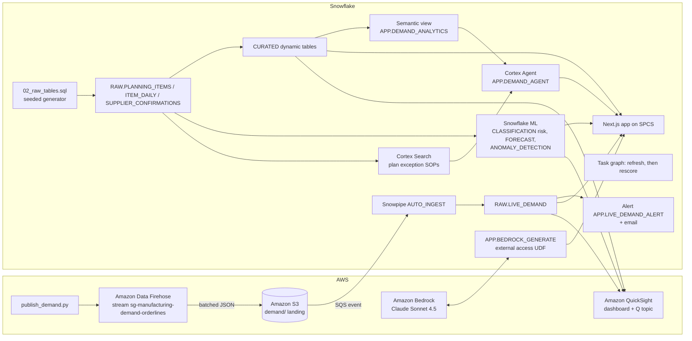

# Singapore Manufacturing Demand Planning - Plan Exceptions and Stockout Risk

End-to-end demand planning for **Straitsline Components, a fictional Singapore manufacturer of components and industrial supplies, with 40 planning items (product families) stocked at 5 distribution centres in Tuas, Woodlands, Pasir Panjang, Changi and Tampines**, using Snowflake and optionally AWS: from a live partner order line to a 7-day stockout risk score, a network demand forecast, an alert email and an AI action memo for the demand planning team. Two of the five DCs sit next to the Pasir Panjang and Tuas container terminals, so the story includes port congestion days that hit every item at a DC at once.

## Architecture

A demand-planning pipeline built on **Snowflake** (Dynamic Tables, Snowflake ML, Cortex Search, Cortex Agent, Cortex AI_COMPLETE, SPCS) and, in the full build, **AWS** (Amazon Data Firehose, S3, Bedrock Claude, QuickSight + Amazon Q). Partner order-line events land in `RAW.LIVE_DEMAND`. Dynamic tables curate 90 days of item-day history: units demanded, demand value in SGD, plan exceptions raised, stockouts, expedited shipments, exception-free day rate and plan review adherence. Snowflake ML scores 7-day stockout risk per planning item, forecasts network-wide daily demand and flags forecast error anomalies. A Cortex Agent answers questions with SOP citations, and an LLM drafts the planning action memo.

Interactive diagrams (hover for object names): [Snowflake only](docs/architecture-snowflake.html) | [AWS + Snowflake](docs/architecture-aws.html). The app shows both on its Architecture & Data tab, the current build first. Regenerate them with `python3 docs/build_architecture.py`.



The Snowflake-only build drops the AWS subgraph: `APP.SIMULATE_DEMAND` writes to `RAW.LIVE_DEMAND`, and the app calls Cortex `AI_COMPLETE` instead of the Bedrock UDF.

## Snowflake Capabilities

| Capability | Implementation |
|-----------|---------------|
| Dynamic Tables | `CURATED.KPI_SUMMARY`, `PERFORMANCE_SUMMARY`, `EXCEPTION_SUMMARY`, `TREND_ANALYSIS` from the RAW tables |
| Snowflake ML | CLASSIFICATION 7-day stockout risk (`ML.STOCKOUT_RISK_SCORES`), 14-day network demand FORECAST (`ML.DEMAND_FORECAST`), forecast error ANOMALY_DETECTION |
| Cortex Search | 14 synthetic plan exception handling SOPs (one per product category and exception type) in `SEARCH.EXCEPTION_SOP_SEARCH` |
| Semantic View | `APP.DEMAND_ANALYTICS` over planning items, exception types, daily totals and risk |
| Cortex Agent | `APP.DEMAND_AGENT`: Cortex Analyst over the semantic view plus Cortex Search for SOP citations |
| Cortex AI | `AI_COMPLETE('claude-sonnet-4-5')` for grounded answers, and for the action memo in the Snowflake-only build |
| Alerts + Tasks | `APP.LIVE_DEMAND_ALERT` logs EXCEPTION events and sends email; task graph `TASK_REFRESH_CURATED`, then `TASK_RESCORE_RISK` |
| Snowpark Container Services | Next.js app `APP.SG_MANUFACTURING_DEMAND_APP` with 6 tabs: Executive Cockpit, Predictive, Controls, Live Demand, Ask AI, Architecture & Data |
| Snowpipe | `RAW.LIVE_DEMAND_PIPE` AUTO_INGEST from S3 (AWS build only) |

## AWS Services

Used only in the AWS + Snowflake build.

| Service | Role in Demo |
|---------|-------------|
| Amazon Data Firehose | Direct PUT stream `sg-manufacturing-demand-orderlines` receives simulated partner order-line events and writes batches to S3 |
| Amazon S3 | Landing bucket (`demand/`). An event notification goes to the Snowpipe SQS queue |
| Amazon Bedrock | Claude Sonnet 4.5 writes the action memo, called from Snowflake through an external-access UDF |
| Amazon QuickSight | DIRECT_QUERY executive dashboard over Snowflake (daily plan exceptions, stockouts by planning item, stockout risk) |
| Amazon Q | Natural-language questions over the QuickSight topic `sg-manufacturing-demand-topic` |
| AWS IAM | Least-privilege roles for S3, Firehose and Bedrock |

## Personas

The company and personas are fictional.

| Persona | Role | Key Questions |
|---------|------|---------------|
| **Rachel Ong** | Head of Demand Planning, Straitsline Components | "What share of item-days run without a plan exception?" "Which exception types turn into stockouts?" |
| **Hafiz Rahman** | Supply Planner, Straitsline Components | "Which planning items are high stockout risk this week, and which SOP applies?" |

## Data

All data is synthetic and seeded, so every rebuild reproduces it. Straitsline Components, its planning items, suppliers and people are fictional; the distribution centre locations are real Singapore planning areas.

| Table | Rows | Description |
|-------|------|-------------|
| RAW.PLANNING_ITEMS | 40 | Planning items at 5 Singapore distribution centres (Tuas, Woodlands, Pasir Panjang, Changi, Tampines; 8 items each) in 5 categories (Electronic components, Automotive parts, Industrial supplies, Packaging materials, Consumer appliances), with supply risk tier and plan review cadence |
| RAW.ITEM_DAILY | 3,600 | Daily item observations over 90 days: units demanded, demand value (SGD), plan exceptions, stockouts, expedited shipments, exception type, plan reviews, forecast error and replenishment lead time |
| RAW.SUPPLIER_CONFIRMATIONS | 40 | Required, received and pending supplier capacity confirmations per planning item |
| SEARCH.EXCEPTION_DOCS | 14 | Synthetic plan exception handling SOPs indexed for Cortex Search |
| RAW.LIVE_DEMAND | Grows during the demo | Live partner order-line events from Firehose (AWS build) or `APP.SIMULATE_DEMAND` (Snowflake-only build) |
| ML.STOCKOUT_RISK_SCORES | 40 | 7-day stockout probability and risk band per planning item |

## Build Instructions

### Prerequisites
- Snowflake account with ACCOUNTADMIN access, and Cortex AI enabled (AI_COMPLETE, Search, Agent).
- An X-Small warehouse with auto-suspend at or below 120 s, and an existing SPCS compute pool.
- Python 3.11+, `snowflake-connector-python`, Node.js 22+, Docker and the `snow` CLI.
- App image: run `snow spcs image-registry login`, then build and push `sg-manufacturing-demand-app:v1` to the database's `APP.IMAGES` repository (see the header of `snowflake/07_deploy_app.sql`).
- AWS build only: `boto3`, AWS credentials for the target account (us-west-2) with Bedrock access, and QuickSight Enterprise.

### SPCS App
```
<DATABASE>.APP.SG_MANUFACTURING_DEMAND_APP
```

### Tests
```bash
python -m pytest aws snowflake quicksight
```

For a local run, put `SNOWFLAKE_ACCOUNT`, `SNOWFLAKE_USER`, `SNOWFLAKE_DATABASE`, `SNOWFLAKE_WAREHOUSE`, `SNOWFLAKE_AUTHENTICATOR=PROGRAMMATIC_ACCESS_TOKEN`, `SNOWFLAKE_TOKEN` and `DEMO_PLATFORM` in the environment, then run `npm --prefix app run build && npm --prefix app start`.

## Build Modes

Both modes share the same core. They differ in three places, and the app's `DEMO_PLATFORM` setting (in its SPCS spec) switches the memo provider and the Live Demand tab.

| Layer | Snowflake Only | Full AWS + Snowflake |
|---|---|---|
| Live demand | `CALL APP.SIMULATE_DEMAND(n)` inserts simulated partner order-line events into `RAW.LIVE_DEMAND`. This simulates a partner demand feed; it is not Snowpipe Streaming | `aws/publish_demand.py` to Amazon Data Firehose, then S3, SQS and Snowpipe AUTO_INGEST |
| Action memo | Cortex `AI_COMPLETE('claude-sonnet-4-5')` | Amazon Bedrock Claude Sonnet 4.5 through `APP.BEDROCK_GENERATE` |
| BI and natural-language questions | The SPCS app is the dashboard; questions go to the Cortex Agent | Also a QuickSight dashboard and an Amazon Q topic |
| App setting | `DEMO_PLATFORM: snowflake` | `DEMO_PLATFORM: aws` |

### Snowflake Only

```bash
# 1. Core data and dynamic tables (guarded: new isolated database only)
python snowflake/run_core.py --database SINGAPORE_MANUFACTURING_DEMAND_SNOWFLAKE --warehouse <XS_WAREHOUSE> --connection <CONNECTION> --apply
# 2. Native demand feed, ML, search, semantic view, agent, alert and task graph
python snowflake/run_intelligence.py --database SINGAPORE_MANUFACTURING_DEMAND_SNOWFLAKE --platform snowflake --warehouse <XS_WAREHOUSE> --connection <CONNECTION> --alert-email you@example.com
# 3. App on SPCS with DEMO_PLATFORM=snowflake (push the image first)
python snowflake/run_intelligence.py --database SINGAPORE_MANUFACTURING_DEMAND_SNOWFLAKE --platform snowflake --warehouse <XS_WAREHOUSE> --connection <CONNECTION> --alert-email you@example.com --files 07_deploy_app.sql --compute-pool <COMPUTE_POOL>
```

During the demo:
- Run `CALL APP.SIMULATE_DEMAND(20)` to add live demand events. For a continuous feed, run `ALTER TASK APP.TASK_SIMULATE_DEMAND RESUME`, and `SUSPEND` it afterwards.
- Run `EXECUTE ALERT APP.LIVE_DEMAND_ALERT` to raise the alert email.
- Run `EXECUTE TASK APP.TASK_REFRESH_CURATED` to refresh the curated tables and rescore risk.

Afterwards, drop the database or run `ALTER SERVICE APP.SG_MANUFACTURING_DEMAND_APP SUSPEND`.

### Full AWS + Snowflake

```bash
# 1. Core data and dynamic tables (guarded: new isolated database only)
python snowflake/run_core.py --database SINGAPORE_MANUFACTURING_DEMAND_AWS --warehouse <XS_WAREHOUSE> --connection <CONNECTION> --apply
# 2. AWS ingestion and Bedrock (dry run first, then --apply)
python aws/setup_aws.py --database SINGAPORE_MANUFACTURING_DEMAND_AWS --account <AWS_ACCOUNT_ID> --connection <CONNECTION> --apply
# 3. ML, search, semantic view, agent, alert and task graph
python snowflake/run_intelligence.py --database SINGAPORE_MANUFACTURING_DEMAND_AWS --platform aws --warehouse <XS_WAREHOUSE> --connection <CONNECTION> --alert-email you@example.com
# 4. App on SPCS with DEMO_PLATFORM=aws (push the image first)
python snowflake/run_intelligence.py --database SINGAPORE_MANUFACTURING_DEMAND_AWS --platform aws --warehouse <XS_WAREHOUSE> --connection <CONNECTION> --alert-email you@example.com --files 07_deploy_app.sql --compute-pool <COMPUTE_POOL>
# 5. QuickSight dashboard and Q topic (needs an existing Snowflake data source)
python quicksight/build_dashboards.py --database SINGAPORE_MANUFACTURING_DEMAND_AWS --account <AWS_ACCOUNT_ID> --principal-arn <QUICKSIGHT_USER_ARN> --data-source-arn <DATA_SOURCE_ARN> --prefix sg-manufacturing-demand --apply --update --with-topic
```

QuickSight objects must be shared with the QuickSight user who signs in (`--principal-arn`); otherwise the console shows nothing.

During the demo:
- Run `python aws/publish_demand.py --count 20` to send live partner order-line events. Firehose buffers for up to 60 seconds before writing to S3.
- Run `EXECUTE ALERT APP.LIVE_DEMAND_ALERT` to raise the alert email.
- Run `EXECUTE TASK APP.TASK_REFRESH_CURATED` to refresh the curated tables and rescore risk.

Afterwards, `python aws/teardown_aws.py --database SINGAPORE_MANUFACTURING_DEMAND_AWS --account <AWS_ACCOUNT_ID> --connection <CONNECTION> --apply` removes the AWS resources and the account-level Bedrock external-access and S3 storage integrations. It leaves the email integration `SG_MANUFACTURING_DEMAND_EMAIL_INT`, which the Snowflake-only build also uses.

## Business Impact

Snowflake customer outcomes:
- **Sub-Zero** (Snowflake customer, manufacturing) uses Snowflake for distribution and shipping analysis: "We’re using Snowflake to improve financial planning and sales analysis, looking at everything from how our distribution centers are performing to how we ship products" -- [Snowflake customer story: Sub-Zero](https://www.snowflake.com/en/customers/all-customers/case-study/sub-zero/)
- **Snowflake paid for itself at Sub-Zero**: "Just by looking at the reduction in warranty claims, truck rolls and operational costs, Snowflake has paid for itself." -- [Snowflake customer story: Sub-Zero](https://www.snowflake.com/en/customers/all-customers/case-study/sub-zero/)

## Key Demo Numbers

These figures are synthetic and come from the seeded demo data. Forecast and anomaly figures can shift slightly with the build day.

- **40 planning items** at 5 Singapore distribution centres across 5 categories, 3,600 item-days over 90 days; **4,341,282 units demanded** worth SGD 82 M
- **Exception-free day rate 85.28%**: **579 plan exceptions** raised, of which **156** ended in a stockout (exception stockout rate 26.9%); **85 expedited shipments**
- **Allocation shortfall** exceptions produce the most stockouts (48 of 175 allocation shortfall exceptions); the 16 port congestion exceptions (Pasir Panjang and Tuas) are always resolved without a stockout. Changi has the most stockouts of the 5 DCs (43)
- **Stockout model** out-of-time holdout: precision 0.39, recall 0.26 at a 0.5 threshold, against a 0.20 base rate (600 item-days). Nine planning items are high risk; the top item is PLN-0013 (Changi, industrial supplies), at 97.4%
- **14-day network demand forecast** averages about 48,500 units a day (90-day history: about 48,200), with prediction intervals; **33 of 640** item-days flagged as forecast error anomalies
- **Plan review adherence 78.1%**, supplier confirmation coverage 58.7%, with 20 confirmations pending
- **14 SOPs** indexed for Cortex Search and cited by ID in agent answers


## License

Apache 2.0 — See [LICENSE](LICENSE) for details.

This is a personal demo project and is not an official Snowflake offering. It comes with no support or warranty. Industry metrics cited are from publicly available Snowflake customer stories; they represent reported outcomes and are not guarantees of results.
